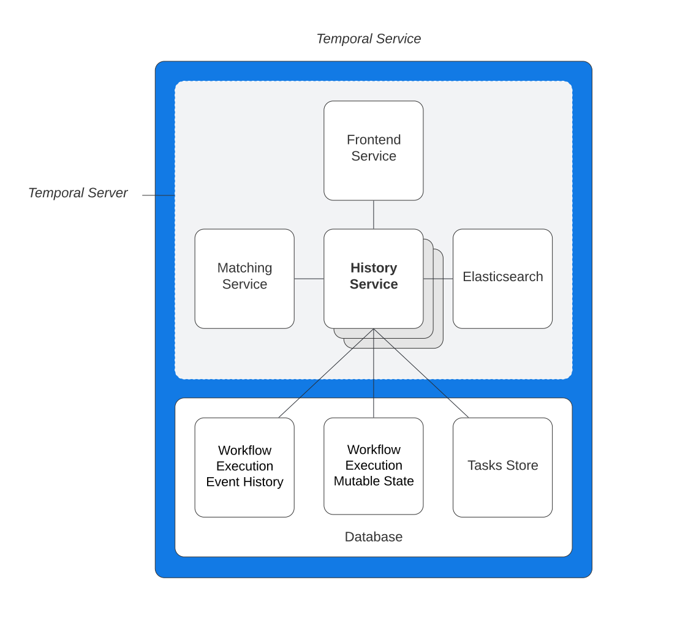
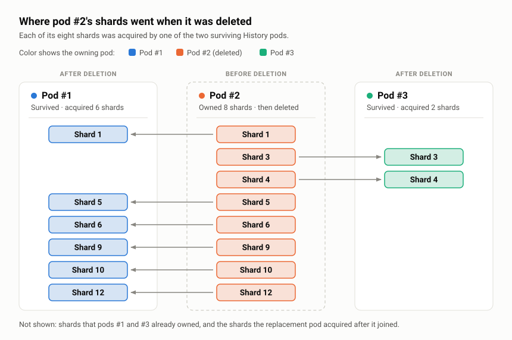
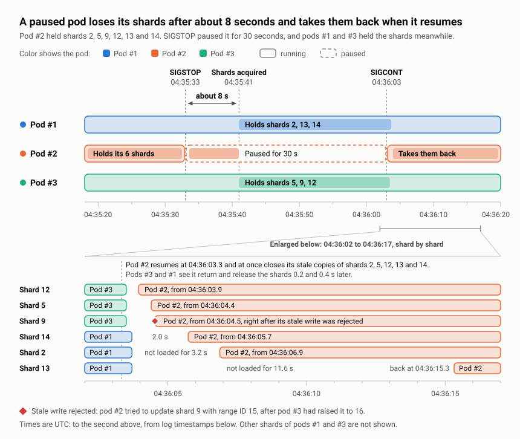
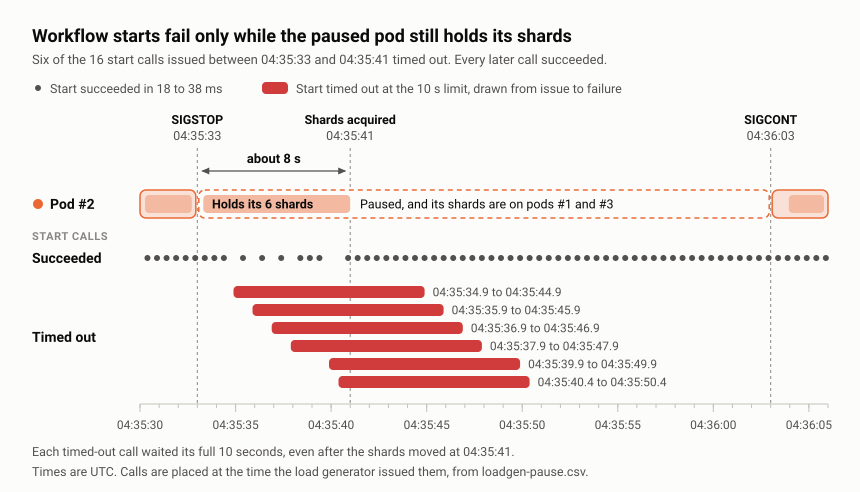
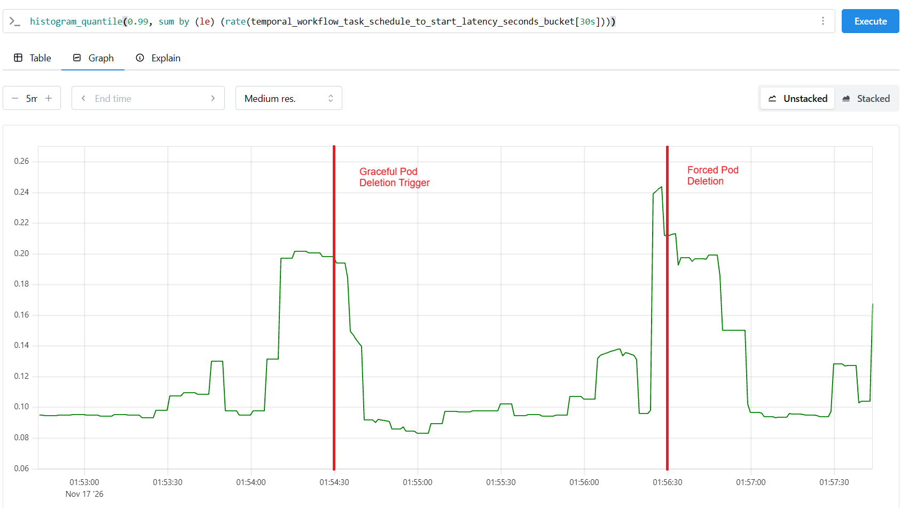

# What Happens to a Long-running Temporal Workflow when Kubernetes Replaces the Pods Underneath It

A [Temporal](https://docs.temporal.io/) workflow that waits days for sign-offs outlives many pods: Temporal's own server pods, and the worker pods that run the workflow code. This analysis will dive deep into the following two questions: 

1. When a Temporal History pod is replaced, what keeps workflow state correct, and what do clients see in the meantime?
2. When worker pods are replaced with new workflow code, which changes break in-flight workflows, how does the failure show up, and which fix suits workflows that run for weeks?

## Environment Setup

I've set up a single-node Kubernetes cluster on Docker Desktop (Windows Edition) as the runtime environment. The source code of environment configuration has been published in [TODO: public GitHub Repository]().

- **Cluster:** Docker Desktop's built-in Kubernetes with one node. One node means there is no node drain to test, and all pods share one machine's CPU. Both belong in the limits section.
- **Temporal:** the official Helm chart 1.8.0, which installs server 1.32.2. It installs only the server components, so the lab runs its own MySQL 8.4. Worker Versioning needs server v1.29.1 or later, so this version is recent enough.
- **Shards:** the lab sets server.config.persistence.numHistoryShards to 16 and runs three History pods. Each pod then owns a handful of shards, and ownership changes are easy to follow. The shard count cannot be changed once the database is in use, which belongs in the limits section.
- **Workflow:** I'm simulating a workflow with approval process, written with Go SDK 1.51.0. It includes: validate (activity), wait for a number of approval signals with a timeout (timer), release (activity), notify (activity). Days are scaled down to seconds for faster experiment cycles.
- **Load:** I created a simulated load generator which starts Temporal workflows at a steady rate and sends each its approvals after random waits. It records latency and errors for every call as CSV. A tenth of the workflows get no approvals, so they run into the timer.
- **Observability:** Prometheus scrapes the server and the SDK every 5 seconds. This lab did not interact with Grafana, though it was provided in the Temporal repository.

## Experiment 1: Replacing a History Pod

The [History Service](https://docs.temporal.io/encyclopedia/architecture/temporal-architecture#history-service) is the part of Temporal that keeps track of everything that happens in each Workflow. It writes ordered event history records to the database so all the events that happen to the workflows are recorded, which eventually achieves determinism and idempotency for the framework. This includes when a Workflow started, Activities ran, Signals were received, timers fired, and when it completed or failed. Figure 1 shows the position of History Service that sits in Temporal universe.

*Figure 1: Temporal Server Diagram*

**Shard** is an important concept in the history service by which concurrent workflow execution throughput can be scaled. Each history shard maps to a single persistence partition; a history shard assumes that only one concurrent operation can be within a partition at a time. In the following experiment, we'll observe and measure the behaviors of different system components around the history service shards.

### Implementation

To answer the question of pod replacement caused outside of Temporal, I'll cover three scenarios that introduce pod disruption in the test environment:

- **Graceful Pod deletion.** Pod deletion is triggered for one of the history service pods via `kubectl delete pod`.
- **Forced Pod Deletion.** Pod is force-deleted without any grace period, i.e. `--grace-period=0 --force`.
- **Pod Pause/Resume.** Pause the history pod by sending SIGSTOP, waits, and sends SIGCONT. The pause lasts as long as 30 seconds to observe the timeouts in load generator, write rejections in history pods, and shard migrations.

For each of the scenario, the following aspects will be covered for fail-recovery of history shards:

- **Time to Recovery.** For a shard, the time from pod defunct to shard recovery will be measured from disruption trigger (pod deletion, pod pause) to the time that a shard is required.
- **Shard Migration.** Shards will have to be migrated once the pod becomes defunct. From the log of other pods, the time of shard migration can be inferred from `Acquired shard` timestamps.
- **Data Write Rejection.** Write to the history database will be rejected if the pod cannot acquire the corresponding shards, and logged as `Failed to lock shard` and increase the counter for `persistence_error_with_type{error_type="persistence_ShardOwnershipLostError"}` in prometheus.
- **Client Timeout.** Load generator in the lab keeps generating new workflow executions. If there are any stream errors and/or deadline exceeded issues, they will be captured in the load generator logs and prometheus metrics.

### Result

I'll cover the results by going through the aspects mentioned above.

**Shard Migration.** Migration of shards is the most direct result from history service pod failures. By defining 16 shards in the history service, each pod owns about 5 shards at a time. Meanwhile, Temporal does proactively rebalance the shards even when there are no pod shutdowns, which may also add some noise in my observation.

Here is a visualized example that I observed from a history pod deletion. Before deletion, pod #2 owns shards 1, 3, 4, 5, 6, 9, 10, and 12. After the pod deletion, shards 3 and 4 are shifted to pod #3, and the other six are assigned to pod #1. Note that shards also reassign to the newly-created pod, including some of these, but I’m only counting the acquired shard in the old pods. Figure 2 shows how these shards are reassigned.

*Figure 2: where pod #2's shards went when it was deleted*

**Time to Recovery.** In graceful and forced pod deletion, the shard migration happened within 1 s (or to be more precise, within around 100 ms) that cannot be measured from the second-level timestamps in etcd. In the `Pod Pause/Resume` scenario, it takes about 8 seconds from sending SIGSTOP until the remaining pods acquiring the shards from paused pods.

Figure 3 shows an example of the timeline. 3 pods were alive in the history service before disruption. SIGSTOP was sent at 4:35:33 UTC time to pod #2. 8 seconds later, at 4:35:41, pod #1 reported that shards 2, 13 and 14 are acquired; pod #3 reported acquisition of shards 5, 9 and 12 at the same second-level timestamp.

*Figure 3: a paused pod's shards are taken over after about 8 seconds*

**Data Write Rejection.** Still in the pause/resume scenario: Pod #2 tried to update shard 9 at 04:36:04.522 and got `Failed to lock shard. Previous range ID: 15; new range ID: 16`. Pod #3 had raised that range ID from 15 to 16 when it acquired the shard at 04:35:41. Figure 3 marks this with a red diamond.

On the other hand, within 0.04 s of resuming, pod #2 closed shards 2, 5, 12, 13 and 14, and no database write was rejected for those. They are also reflected in Figure 3.

**Client Timeout.** Shifting from the history pod behavior to workloads. In `Pod Pause/Resume` scenario, load generator reports `deadline exceeded` and `stream terminated` errors within the 8 seconds time window. There are no issues seen immediately after the shard re-acquisition. Figure 4 shows how the workflow that start in the disruption window are affected. 

*Figure 4: workflow starts fail only while the paused pod still holds its shards*

### Conclusion

Returning to our first question—*when a Temporal History pod is replaced, what keeps workflow state correct, and what do clients see in the meantime?*

**Correctness comes from shard-level fencing in the database, backed by task-clock checks in memory.** Workflow histories live in MySQL, not in pod memory. Every time a History pod acquires a shard, it atomically increments that shard's `range_id` and claims the next block of `2^20` task IDs. When our paused pod resumed after losing its six shards, five shards immediately shut themselves down within 40 ms after loading timer-queue tasks (workflow-task and activity timeouts) whose IDs came from the new owners' higher ranges (`task clock validation failed`). The sixth shard (shard 9) stayed open until a signal arrived 1.2 s later, tried to commit with its stale `range_id = 15`, and was rejected by the range-ID check inside the MySQL transaction (`Previous range ID: 15; new range ID: 16`). It immediately closed and re-acquired the shard at `range_id = 17`, and the signal was retried automatically, so the caller still succeeded in 47 ms.

**What clients see depends on whether the failure closes sockets or freezes the process:**

- **Pod termination (graceful or forced):** Surviving pods take over the lost shards within about 200 ms of noticing the pod is gone, broken sockets fail fast, and Frontend retries internally. Across 1,330 client calls in the two deletion runs, **zero calls failed**, and worst-case latency rose from ~30 ms to 222 ms (graceful) and 465 ms (forced).
- **Process freeze (`SIGSTOP`, analogous to a long GC pause or host stall):** Because the kernel keeps TCP sockets open - the chart's TCP liveness probe never restarted the pod during the 30 s pause - it takes **~8 s** to evict the pod and reassign its shards. Calls routed to those shards during that 8 s window hang on the frozen socket until the client's 10 s deadline expires (6 of 16 `start` calls and 4 `signal` calls failed), while shards on healthy pods are unaffected. Once shard takeover completes at ~8 s, new calls succeed immediately.

## Experiment 2: Removing Workers

This section dives into the disruption caused by removing the worker pods while the workflows are in flight.

### Implementation

I'm building the lab environment and load generator based on the existing work from experiment 1. The difference is the metrics that we're watching in Prometheus:

- **Workflow Task Start Latency**. Captured from `temporal_workflow_task_schedule_to_start_latency_seconds`. This is how long a workflow task waited before a worker picked it up. The worker that receives the task reports it, so surviving and new pods show the wait.
- **History Replay.** Captured from `temporal_workflow_task_replay_latency_seconds`. This is the time a worker spent rebuilding a workflow’s state from its history.
- **Cache Misses.** Captured from `temporal_sticky_cache_miss_total`. It counts tasks for workflows the worker did not have in memory, which is what forces a replay.

### Results

I've observed no significant latency changes, replays and cache misses from either graceful shutdown via `kubectl rollout restart` or forced pod deletion.

Replays and cache misses showed consistent zero; latency changes are recorded in Figure 5. 

*Figure 5: workflow task latency changes*

Note that the latency varies a lot from the observation, even when there are no disruptions. This is likely related to the process scheduling with Hyper-V on Windows, since the cluster resides in Docker Desktop with Hyper-V engine.

## Experiment 3: Swap Worker Image Mid-flight

This section will describe the behavior caused by swapping worker image while the workflows are running.

### Implementation

Still based on the framework in experiments 1 and 2, but this time I'll focus on the behavior of workflows (passed, failed) from swapping the worker images.

### Result

| Change to workflow code | Detected on replay? | What happens to the workflow |
|---|---|---|
| Add an activity before an existing step | Yes | `A non-deterministic error has caused the Workflow Task to fail. This usually means the workflow code has a non-backward compatible change without a proper versioning branch.` |
| Remove an activity | Yes | Same as above |
| Reorder two activities | Yes | Same as above |
| Change an activity's arguments | No (Docs say this is not checked) | Completed |
| Change a timer's duration | No (Docs say this is not checked) | Completed |
| Change only an activity's implementation | No | Completed |

### Conclusion

Returning to our second question - `When worker pods are replaced with new workflow code, which changes break in-flight workflows, how does the failure show up, and which fix suits workflows that run for weeks?`

Abrupt changes will be detected when workflow implementation is changed (like adding activities, removing activities or changing the order). But this is not 100% guaranteed to be failure - once the workers are fully replaced, the new workflows will not be affected. However, workflows that experience worker swaps during the execution will be hurt.

On the activity side, however, changing the implementation and / or parameters will not disrupt the workflows mid-flight. That may be related to how Temporal is designed for coordination among workers.

Specifically, Temporal workers never share process memory or hand off live goroutines when Kubernetes replaces a pod; instead, they coordinate exclusively through the server's append-only **Event History** and **Task Queues**. When a new worker picks up an in-flight workflow, it rebuilds local state by re-executing the workflow function from the beginning against the recorded history (**replay**). During replay, the SDK does not re-run completed steps—it checks only that the sequence of **Commands** emitted by the workflow code (`ScheduleActivityTask`, `StartTimer`, etc.) matches the recorded events in type, order, and activity name, then feeds the stored results back into the code. Structural edits (adding, removing, or reordering activities) break this 1-to-1 command alignment and trigger a non-determinism error—which, under the Go SDK's default `BlockWorkflow` policy, does not terminate the workflow outright, but stalls and retries the workflow task until the code is rolled back or patched. By contrast, an **Activity** is a stateless side-effect boundary dispatched independently over the task queue: once `ActivityTaskCompleted` is recorded in history, replay never invokes the activity code again, nor does the SDK's replay check compare serialized activity arguments or timer durations against what was originally scheduled. (During a mixed-version rolling update, however, an activity scheduled by an old pod can still be executed by a new pod, so changing an activity's parameter signature in-place remains unsafe unless parameters stay backward-compatible or tasks are version-routed.)
